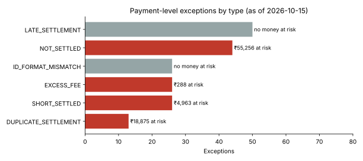

# AI-Assisted Payment Reconciliation Engine

Automates the daily **three-way reconciliation** a payments finance team runs: our **gateway ledger** vs the acquiring bank's **settlement report** vs our **bank statement**. It matches 40,000 payments in under 2 seconds, raises a prioritised exception register with owners and next actions, and uses **Claude** to triage the cryptic bank-statement lines that rule-based matching can't explain.

On the test dataset it detects **100% of injected breaks with 100% precision** across 8 break types, and auto-matches **99.54%** of payments with no manual work.

> Built to mirror the work of a Data Analyst in a fintech Business Finance team: process automation, data accuracy and AI-powered workflows.

---

## The problem

Every rupee a payment company collects has to be traced from *"customer paid"* to *"money landed in our bank"* to *"merchant was paid."* Done manually in Excel this is slow, error-prone, and money leaks through unnoticed short settlements, duplicate credits and excess fees.

| Manual reconciliation | This engine |
|---|---|
| VLOOKUPs across three exports | SQL matching in two passes (exact ID, then normalised ID) |
| Batch credits checked by eye | Every UTR batch total checked against the bank credit |
| Bank drops the UTR, analyst searches by hand | Fallback match on value date + exact amount (1:1 only, so no false matches) |
| "What is *CHGBK DR CASE#4411*?" | Claude classifies unexplained lines, assigns an owner and a next action |
| Exceptions in a long unsorted list | Prioritised P1–P4 by money at risk, with ageing buckets |

## How it works

```
gateway_ledger.csv ──┐
                     ├─ Level 1 · payment match ── exact payment_id
settlement_report ───┤                          └─ normalised id (case / separator fixes)
                     │      → NOT_SETTLED, SHORT_SETTLED, EXCESS_FEE, DUPLICATE_SETTLEMENT,
                     │        LATE_SETTLEMENT, ID_FORMAT_MISMATCH, NOT_IN_LEDGER
                     │
                     ├─ Level 2 · batch match ──── UTR parsed from narration (regex)
bank_statement.csv ──┤                          └─ value date + exact amount when UTR is missing
                     │      → BATCH_TOTAL_MISMATCH, MATCHED_WITHOUT_UTR, BATCH_NOT_IN_BANK
                     │
                     └─ Level 3 · AI triage ────── Claude classifies leftover bank lines
                            → CHARGEBACK, REVERSAL, BANK_CHARGES, PAYOUT_RETURN,
                              INTEREST, REFUND_REVERSAL, UNIDENTIFIED_CREDIT
```

All matching logic is plain SQL in [`sql/recon.sql`](sql/recon.sql) (CTEs, window functions, anti-joins), so it ports to Postgres, Snowflake or BigQuery.

## Results (as of 15 Oct 2026, synthetic data)

| Metric | Value |
|---|---|
| Ledger payments | 40,000 |
| Auto-match rate | **99.54%** |
| Matched only after ID normalisation | 26 |
| Open payment exceptions | 185 |
| Amount at risk | **₹79,381.81** |
| UTR batches checked against bank | 12,008 |
| Run time | ~1.7 s |



**Detection accuracy.** The data generator records exactly which breaks it injected, so the engine is scored like a classifier:

| Level | Break type | Injected | Detected | Precision |
|---|---|---|---|---|
| Payment | NOT_SETTLED | 44 | 44 | 100% |
| Payment | SHORT_SETTLED | 26 | 26 | 100% |
| Payment | EXCESS_FEE | 26 | 26 | 100% |
| Payment | DUPLICATE_SETTLEMENT | 13 | 13 | 100% |
| Payment | LATE_SETTLEMENT | 50 | 50 | 100% |
| Payment | ID_FORMAT_MISMATCH | 26 | 26 | 100% |
| Batch | BATCH_TOTAL_MISMATCH | 8 | 8 | 100% |
| Batch | MATCHED_WITHOUT_UTR | 6 | 6 | 100% |
| Bank triage | Correct category | 19 | 19 | 100% |

Full sample output: [`output/recon_summary_2026-10-15.md`](output/recon_summary_2026-10-15.md)

## Where Claude fits, and the guardrails

Keyword rules handle bank narrations in formats they've seen before. They break as soon as a bank changes its wording (for example, `DSPT ADJ CB-77812` is a chargeback, but no rule catches it). Claude handles these unseen formats. Because this is money, its output is never trusted blindly:

1. **Minimal data.** Claude only sees the narration, date and amount of lines that already failed matching. No customer or merchant data is sent.
2. **Strict schema.** The response must be JSON, and every label is validated against the 7 allowed categories.
3. **Confidence threshold.** Answers below 0.7 confidence fall back to the keyword rules.
4. **Human in the loop.** When Claude and the rules disagree, or the line is an unidentified credit, it is marked `needs_review`.
5. **Never breaks the run.** With no API key or an API failure, keyword rules run alone.

These guardrails are covered by tests with a mocked Claude response ([`tests/test_recon.py`](tests/test_recon.py)).

## Outputs

- **`recon_exceptions_<date>.xlsx`**: Summary, By Category, Payment Exceptions (colour-coded P1/P2/P3), Batch Exceptions, Bank Triage, Detection Accuracy; frozen headers and filters on every sheet
- **`bi_*.csv`**: flat files ready to load into **Power BI** or **Tableau**
- **`recon_summary_<date>.md`** and **`exceptions_by_type.svg`**

Every exception carries `owner`, `next_action`, `amount_at_risk`, `age_days`, an ageing bucket (0-2 / 3-7 / 8-15 / 15+ days) and a priority.

## Quick start

```bash
git clone https://github.com/Abhi1803-hash/Payment-Reconciliation-Automation.git
cd Payment-Reconciliation-Automation
pip install -r requirements.txt

python src/generate_data.py               # 40k payments, 600 merchants, Sep 2026
python -m src.recon --as-of 2026-10-15    # writes output/ in ~2 seconds

# optional: Claude triage of bank lines
export ANTHROPIC_API_KEY=sk-ant-...
python -m src.recon --as-of 2026-10-15

python -m pytest -q                       # 6 tests: detection, false positives, AI guardrails
```

The GitHub Actions workflow in [`.github/workflows/daily_recon.yml`](.github/workflows/daily_recon.yml) runs the tests and the reconciliation every weekday morning and uploads the exception register.

## Project structure

```
├── src/
│   ├── generate_data.py   # ledger, settlement report, bank statement + injected breaks + answer key
│   ├── recon.py           # orchestration, ageing, priority, Excel/CSV/Markdown output, accuracy scoring
│   └── ai_triage.py       # Claude classification of bank lines, validation, fallback rules
├── sql/recon.sql          # all matching logic
├── tests/test_recon.py
├── output/                # sample output
└── .github/workflows/daily_recon.yml
```

## Tech stack

**SQL** (SQLite; CTEs, window functions, anti-joins) · **Python** (pandas, NumPy, regex, openpyxl, matplotlib) · **Claude API** (Anthropic SDK, JSON-validated outputs) · **Excel** · Power BI-ready CSVs · **GitHub Actions** · pytest

## About the data

All data is **synthetic**, generated with a fixed seed so results are reproducible. Settlement timing (T+2 business days), MDR by payment method, 18% GST on fees, UTR-based batch credits and bank narration styles are modelled on how Indian payment gateways operate, but no real company's data is used.
